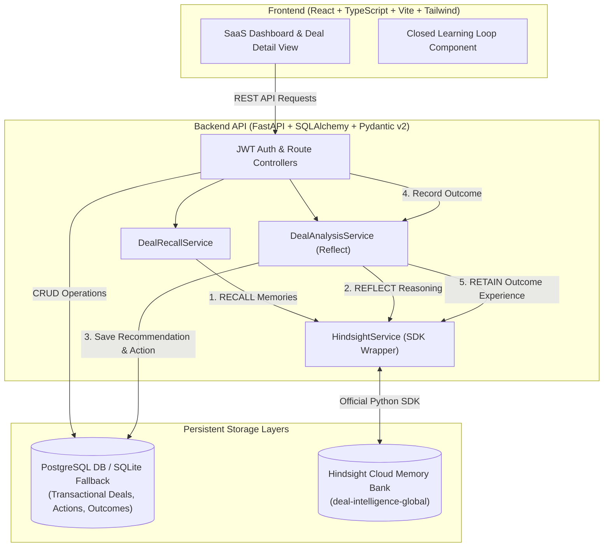
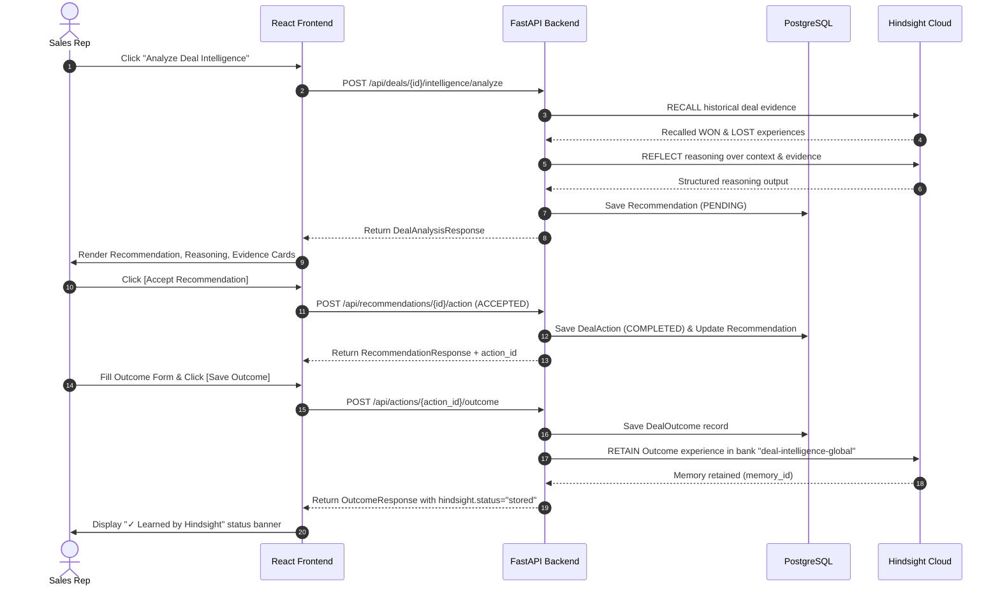

# Deal Intelligence Agent — Architecture Documentation

## 1. Executive Summary

The **Deal Intelligence Agent** is an evidence-driven sales intelligence system that bridges relational CRM transactional data (PostgreSQL) with persistent agent experience memory (**Hindsight Cloud**).

Rather than treating LLM recommendations as one-off stateless prompts, the agent maintains a continuous learning feedback loop:

$$\text{RETAIN} \longrightarrow \text{RECALL} \longrightarrow \text{REFLECT} \longrightarrow \text{RECOMMEND} \longrightarrow \text{HUMAN DECISION} \longrightarrow \text{ACTION} \longrightarrow \text{OUTCOME} \longrightarrow \text{RETAIN}$$

---

## 2. High-Level System Architecture

---

## 3. Data Layer Separation of Responsibilities

A core architectural principle of the Deal Intelligence Agent is the strict decoupling between **relational business state** and **agent experience memory**:

### 3.1. PostgreSQL / SQLite (Transactional Application State)
- **Identity & Security**: Users, password hashes, JWT authorization roles (`sales_rep`, `manager`, `admin`).
- **CRM Domain Entities**: Companies, Contacts, Deals, Stages (`DISCOVERY`, `QUALIFICATION`, `TECHNICAL_EVALUATION`, `PROPOSAL`, `NEGOTIATION`, `CLOSED_WON`, `CLOSED_LOST`), Deal Values, Probabilities.
- **Activity Records**: Interactions (Calls, Meetings, Emails, Internal Notes, Demos, Technical Reviews).
- **Human-in-the-Loop State**: Persisted `Recommendation` records (Status: `PENDING`, `ACCEPTED`, `REJECTED`), `DealAction` execution records, and `DealOutcome` results (`POSITIVE`, `NEGATIVE`, `NEUTRAL`, `UNKNOWN`).

### 3.2. Hindsight Cloud (Persistent Agent Memory & Experience)
- **Memory Retention**: Storing structured deal experiences dynamically tagged with `deal:<id>`, `company:<id>`, `stage:<stage>`, `type:outcome`, `type:action`, `outcome:<type>`.
- **Semantic & Multi-Arm Recall**: Searching past won/lost deal experiences using BM25 keyword matching, vector embeddings, entity graphs, and temporal proximity.
- **Synthesized Reflection**: Running Hindsight `REFLECT` reasoning over recalled evidence to detect cross-deal patterns, identified risks, and next-action recommendations.

---

## 4. The Closed Learning Loop Workflow

---

## 5. Resilience & Error Handling Architecture

The application is engineered with high resilience:
1. **Graceful Memory Fallback**: If Hindsight Cloud credentials are unconfigured or Hindsight Cloud returns `402 Payment Required` (insufficient credits), PostgreSQL transactional operations (actions, outcomes, deal creation) succeed cleanly.
2. **Safe API Responses**: Status messages clearly indicate `hindsight.status="unavailable"` or `hindsight.status="not_configured"` without throwing 500 errors or returning fake data.
3. **Async Event Loop Safety**: All Hindsight SDK calls use native `a`-prefixed async methods (`aget_version`, `acreate_bank`, `aretain`, `arecall`, `areflect`), avoiding nested event loop execution (`asyncio.run` conflicts).
